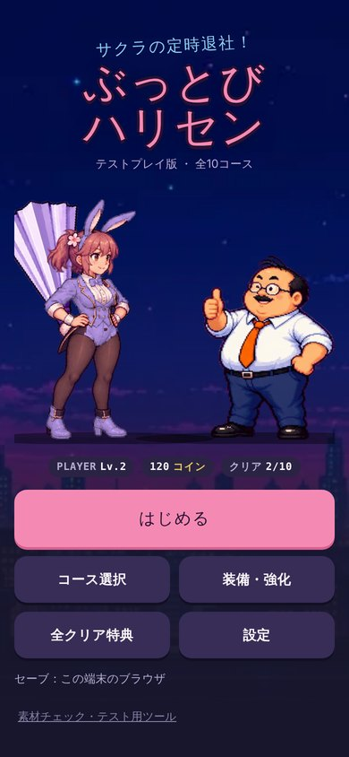
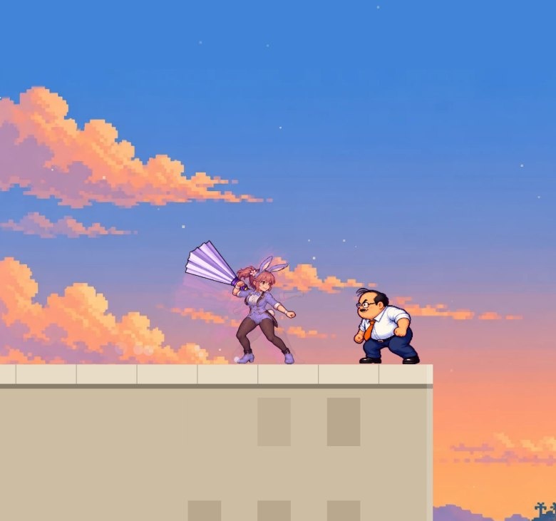
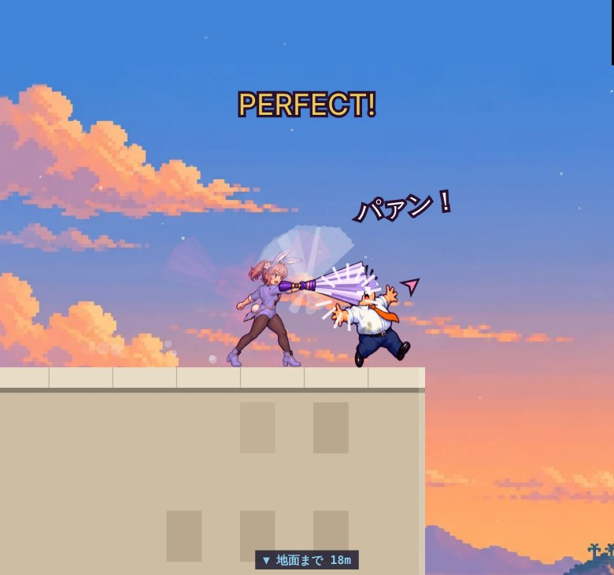
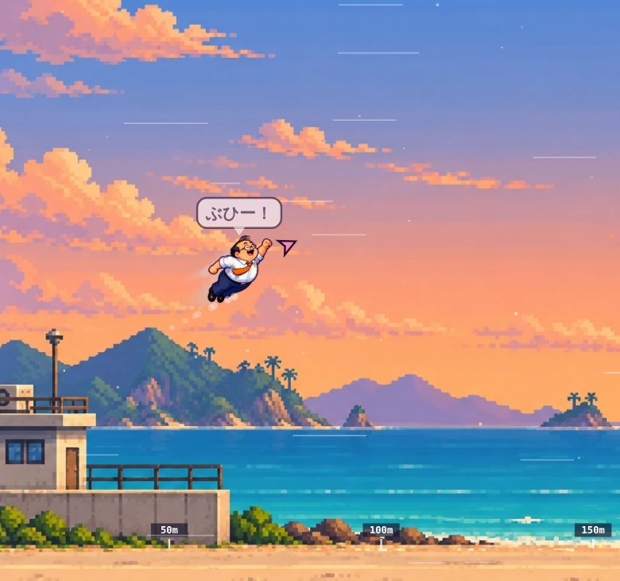

# サクラの定時退社！ぶっとびハリセン — テストプレイ版（2026-10-04）

仕事を押し付けてくる部長を、バニー衣装のサクラが巨大な紙ハリセンで屋上からぶっ飛ばす。助走の終わりに一度だけタップして、最初の着地点までの飛距離を競う、2D横視点のブラウザゲームです。全5ワールド・10コース。

| タイトル | 振りかぶり | 打撃（PERFECT） | 飛行 |
|---|---|---|---|
|  |  |  |  |

## ブラウザで遊ぶ

**https://infoairen7.github.io/sakura-harisen/**

スマホでもPCでも、このURLを開くだけで遊べます（GitHub Pages で配信）。縦持ちを優先していて、横持ち・PCでも遊べます。進行（レベル・コイン・装備・クリア記録・自己ベスト）は、そのブラウザの中にだけ保存されます。

- **実機（iPhone・Android・PCの実ブラウザ）では未確認です。** 確認はこの制作環境のヘッドレスChromiumと自動テストで行いました。
- 構成：ライブラリなしの JavaScript ＋ Canvas 2D。数値はすべて `public/config/game_balance.json`、画像の切り出し矩形は `public/config/asset_manifest.json` から読みます。

## 遊び方

1. コースを選んで「屋上へ行く」。
2. 「走り出す」で助走が始まります。
3. サクラの足もとの輪が床の ◆ に重なった瞬間に「たたく」（PCは Space／Enter でも可）。一度押したら、その回はもう押せません。
4. 判定（PERFECT／GREAT／GOOD／GRAZE／MISS）と装備・レベルで飛距離が決まります。目標距離を超えるとクリア。
5. コインでハリセンとバニー衣装を強化し、経験値でPLAYERレベルを上げて、次のコースへ。

| 判定 | タイミングのずれ | 初速倍率 |
|---|---:|---:|
| PERFECT | 40ms以内 | 1.08 |
| GREAT | 85ms以内 | 0.96 |
| GOOD | 140ms以内 | 0.82 |
| GRAZE | 210ms以内 | 0.58 |
| MISS | それ以外・無入力 | 飛ばない |

練習モード（コース確認画面）では判定の幅が1.5倍になります。記録・クリア・報酬は付きません。

## 全10コース

| ワールド | コース | 名前 | 目標 | 環境 |
|---|---:|---|---:|---|
| ネオンビル | 1 | 残業フロア | 130m | 標準 |
| ネオンビル | 2 | 終電チャレンジ | 180m | 標準 |
| 海岸 | 3 | 潮風オフィス | 240m | 追い風 |
| 海岸 | 4 | サンセット退勤 | 280m | 追い風 |
| ジャングル | 5 | 会議の密林 | 340m | やや強い重力 |
| ジャングル | 6 | 決裁の滝 | 390m | やや強い重力 |
| 氷山 | 7 | 凍結プロジェクト | 470m | 弱い向かい風 |
| 氷山 | 8 | 極寒の承認待ち | 540m | 弱い向かい風 |
| マグマ山地 | 9 | 炎上案件 | 620m | 弱い追い風・軽い重力 |
| マグマ山地 | 10 | 最終退勤 | 700m | 弱い追い風・軽い重力 |

## キャラクターの動き

素材は1キャラにつき8ポーズの一枚絵です。そのため、次の処理をコードで重ねて、動きをなめらかに見せています。

- **中割り**：ポーズとポーズの間をクロスフェードでつなぐ（走り2枚の交互、振りかぶり→振り抜き→フォロースルー、喜びの2ポーズ）。
- **伸び縮み**：接地でつぶれて空中で伸びる、打撃の瞬間に部長がつぶれる、着地で弾むなど。
- **残像**：助走・スイング中のサクラと、飛んでいる部長の少し前の姿を半透明で重ねる。
- **ハリセンの軌跡**：ハリセンは別画像なので、角度と手の位置を毎フレーム補間し、振り抜きの軌跡に複数枚を重ねる。
- **ヒットストップ**：PERFECTは60ms止めて、打撃の瞬間を見せる。

動きはすべて「時刻の関数」なので、フレームレートが違っても同じ動きになり、記録にも影響しません。「設定 → 揺れ・演出を減らす」で、残像と揺れを止められます。

## 起動のしかた（手元）

| やりたいこと | 方法 |
|---|---|
| すぐ遊ぶ | 上のURLを開く |
| 手元のサーバーで開く | `cd dist && python3 -m http.server 8765` → http://localhost:8765/ |
| 作り直す | `python3 build.py https://infoairen7.github.io/sakura-harisen/`（`src/` と `public/` から `dist/` を作る） |
| テスト | `pip install playwright` のうえ、サーバーを起動して `python3 tests/functional.py` |

`dist/index.html` を `file://` で直接開くと設定JSONを読めないので、必ずWebサーバー経由で開いてください。

## フォルダ

| パス | 内容 |
|---|---|
| `src/game.js` | ゲーム本体（判定・物理・育成・保存・描画・アニメーション・結果画像） |
| `src/style.css` / `src/body.html` | 画面とUI |
| `public/assets/` | 配信用の画像（原本PNGと同じ寸法のWebP、衣装色替えマスク、上司シャツのマスク、コース一覧の縮小画像） |
| `public/config/` | 設定JSON（数値の正本）と素材の矩形 |
| `dist/` | 公開しているサイトそのもの（`build.py` が作る） |
| `tests/` | Playwrightによる自動テストと画面撮影 |
| `docs/実装メモ.md` | 実装状況・未実装・仕様からの調整点 |

## 実装していないこと

- **全クリア特典（ブロマイド）の限定ダウンロード**：サーバーが必要なため未実装です。全10コースをクリアすると「解放」と表示されるところまでです。特典画像は、このリポジトリにもサイトにも含めていません。
- サーバーで記録を検証する仕組み（現在はブラウザ内で計算しています）。
- 「素材チェック・テスト用ツール」（コイン付与・全クリア化）は、テストプレイ用に残しています。

## 自動テストの結果

- 同じタイミングで押せば、30／45／60／120／144fps のどれでも飛距離の差は 0.000000m。
- 判定の境界：40.0ms＝PERFECT、40.1ms＝GREAT、85.1ms＝GOOD、140.1ms＝GRAZE、210.1ms＝MISS（各区間の上限を含む）。
- 推奨装備でPERFECTを出したときの飛距離は、企画の検算値と全10コースで一致。
- 初回クリアボーナスは1回だけ、リロードしても進行が残る、壊れたセーブは確認してから初期化、タブを離れると一時停止。
- 全部PERFECTで強化しながら進めると、25プレイで全コースクリア・装備Lv10・PLAYER Lv5に届く。

## 素材とフォント

- キャラクター・装備・背景は、この作品のために画像生成で作った新規デザインです。第三者作品の画像・既存IP名・企業ロゴは使っていません（権利非侵害の法的な保証や商標調査は行っていません）。
- 登場人物（サクラ28歳・丸岡部長52歳）は架空の成人です。
- フォントは Google Fonts から読み込みます（Dela Gothic One、Martian Mono。いずれも SIL Open Font License 1.1）。読み込めない環境では端末のフォントで表示します。
- 効果音は Web Audio で合成しています（音声ファイルは使っていません）。
